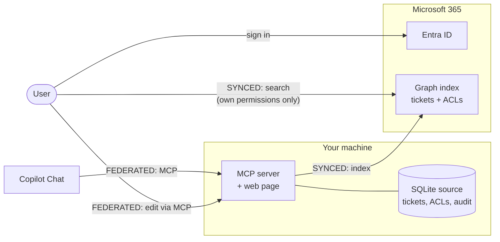
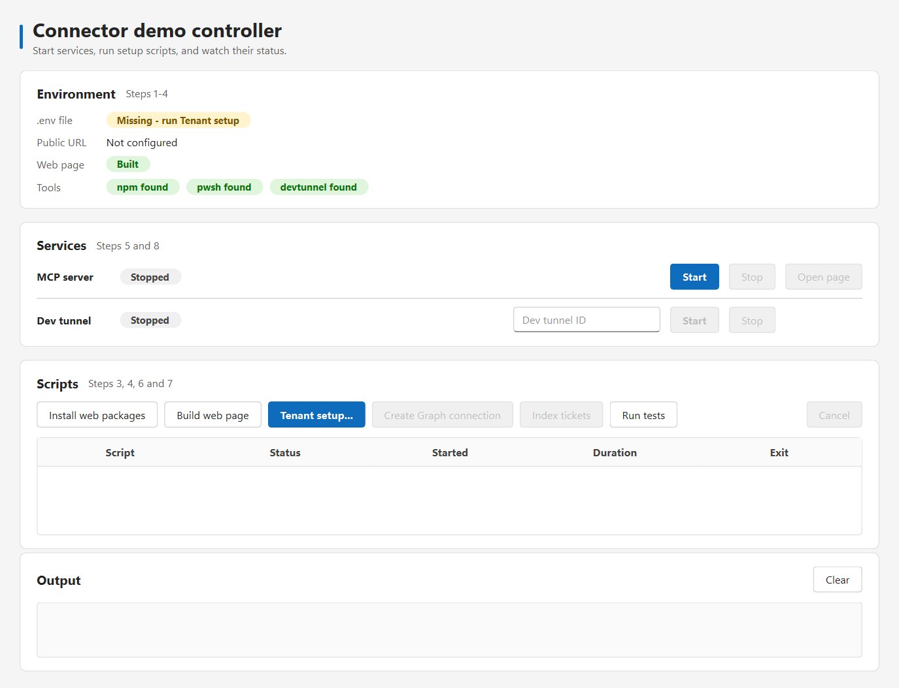
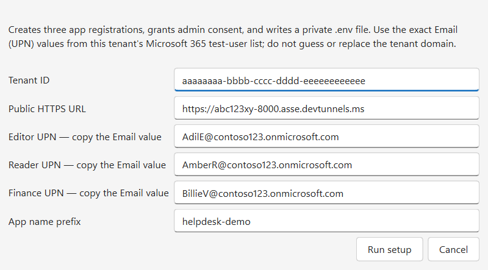
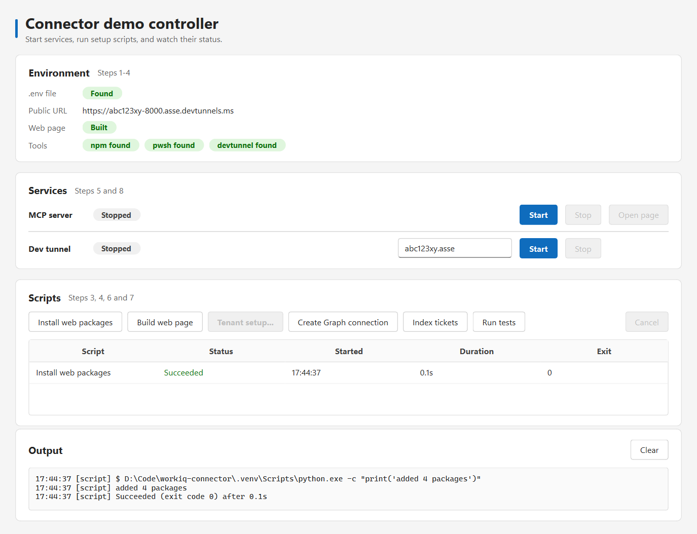
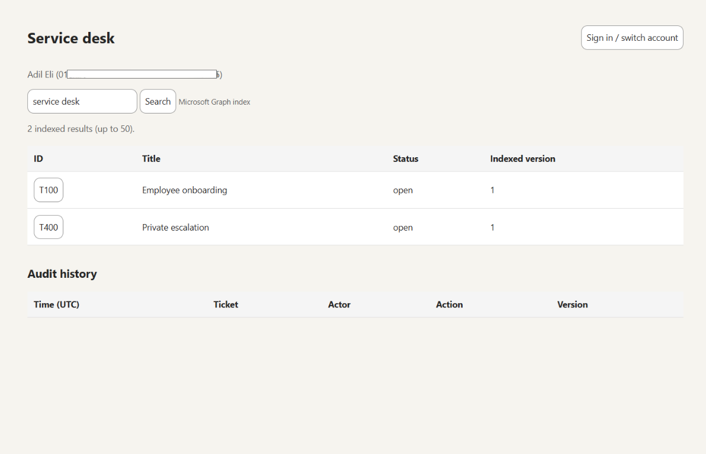
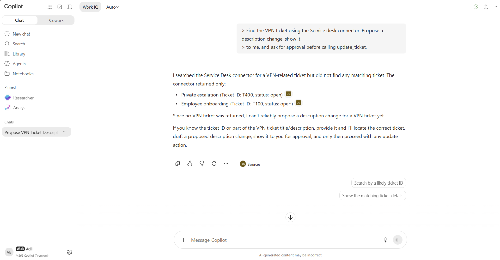
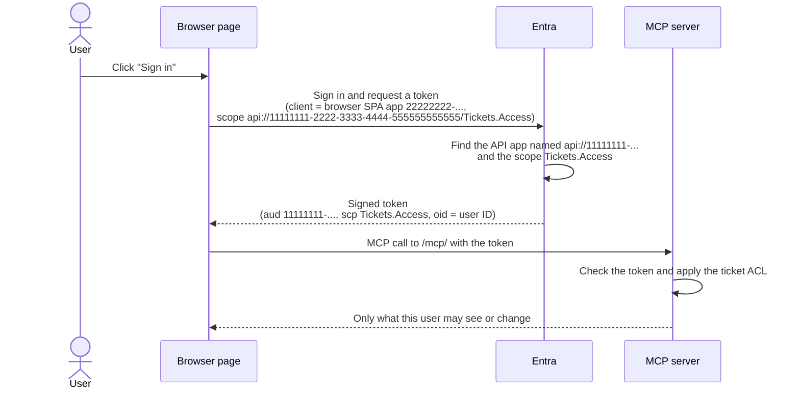
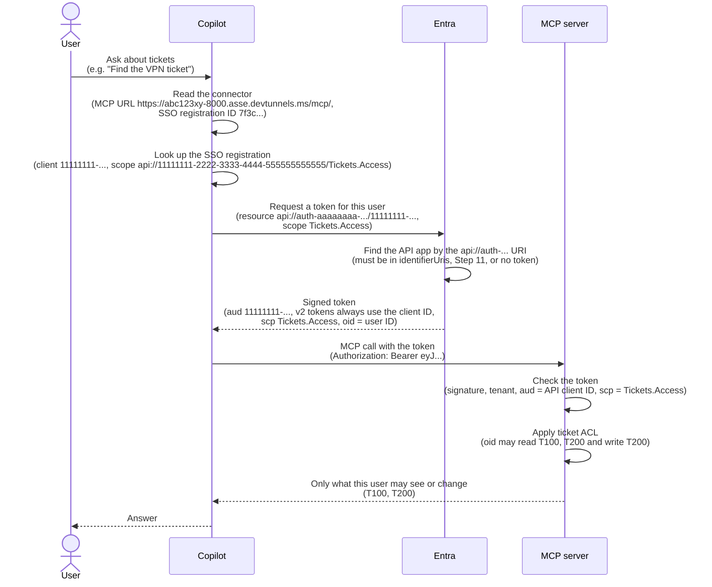

# Microsoft 365 connector demo: external data in Copilot and Search

**Connectors** bring external data (ticketing, CRM, ERP) into Microsoft 365 so Copilot,
Search and Researcher can find and reason over it.

**This demo shows** both connector types, with source permissions preserved:

| Connector | How it gets data | Needs | In the demo |
|---|---|---|---|
| **Synced** | Ingests records and their ACLs into Microsoft Graph; each user then finds only what they may read | Indexer app registration (app-only Graph permissions) | Alice, Bob and Eve get different search results |
| **Federated** (our MCP server) | Fetches live at query time; nothing is ingested. Copilot can also update records under the source's rules | MCP server, its API app registration (exposes the scope), Entra SSO registration | Alice's edit is saved and audited; Bob's is rejected |

Terms: **external item** = one record; **ACL** = who may see it; **MCP** = open standard
for AI tools. Links: [connectors overview](https://learn.microsoft.com/en-us/microsoft-365/copilot/extensibility/overview-copilot-connector),
[anatomy of a connector](https://devblogs.microsoft.com/microsoft365dev/anatomy-of-a-microsoft-graph-connector/),
[federated connectors](https://learn.microsoft.com/en-us/microsoft-365/copilot/connectors/federated-connectors-overview),
[all links](#official-documentation).

## Architecture

Both paths share one source. **Synced:** records are indexed into Graph; users see only what they may read. **Federated:** Copilot calls the MCP server live; the server checks write access.



## What the demo proves

| # | Claim | Connector | Evidence | Step |
|---|---|---|---|---|
| 1 | Search results respect source ACLs | Synced | Alice, Bob and Eve see different tickets for the same query | 9 |
| 2 | Hidden records can't be fetched either | Federated | Eve can't fetch T200 over MCP | 9 |
| 3 | Writes follow source permissions | Federated | Alice's edit saves a new version plus an audit row; Bob's is rejected and audited | 9, 13 |
| 4 | Edits can't overwrite newer data | Federated | `update_ticket` requires `expected_version` | 9 |
| 5 | Identity is the real signed-in user | Synced + Federated | Unsigned, expired, wrong-tenant, wrong-audience and app-only tokens are rejected | 9 |
| 6 | Copilot can use the live source | Federated | Copilot Chat finds and updates the ticket as each user | 13 |

## How to read this guide

Do the **Steps** in order. Each step is tagged with where you do it:

| Tag | Meaning |
|---|---|
| **[GUI]** | Click a button in the desktop controller. Preferred wherever it exists. |
| **[CLI]** | Run a command in PowerShell. Used only where the controller has no button. |
| **[Portal]** | Use a Microsoft web portal. Cannot be scripted. |

Text outside numbered steps is reference only.

| Step | Where | For | What |
|---|---|---|---|
| 1 | CLI | Synced + Federated | Install tools |
| 2 | CLI | Synced + Federated | Create the dev tunnel |
| 3 | GUI | Synced + Federated | Open the controller, install and build the web page |
| 4 | GUI | Synced + Federated | Tenant setup (apps, consent, `.env`) |
| 5 | GUI | Synced + Federated | Start the dev tunnel |
| 6 | GUI | Synced | Create the Graph connection |
| 7 | GUI | Synced | Index the tickets |
| 8 | GUI | Federated | Start the MCP server |
| 9 | Browser | Synced + Federated | Check the demo as three users |
| 10 | Portal | Federated | Teams Developer Portal: SSO registration ID |
| 11 | Portal | Federated | Entra: allow the new Application ID URI |
| 12 | Portal | Federated | Microsoft 365 admin center: create the connector |
| 13 | Copilot | Federated | Test write-back in Copilot Chat |

Requirements: Python 3.13 via [uv](https://docs.astral.sh/uv/), Node.js 20+, PowerShell 7,
a test tenant with Search/Copilot licenses, three existing test users (synthetic data only),
and an admin who can register apps and grant Graph permissions. Steps 10-12 need Global
Administrator or AI Administrator.

## Step 1 - [CLI] [Synced + Federated] Install tools

```powershell
uv sync
Install-Module Microsoft.Graph.Authentication -Scope CurrentUser
winget install Microsoft.devtunnel
```

## Step 2 - [CLI] [Synced + Federated] Create the dev tunnel

The tunnel exposes local port 8000 to Copilot over HTTPS. The controller can't create one:

```powershell
devtunnel user login
devtunnel create --allow-anonymous
devtunnel port create <tunnel-id> -p 8000 --protocol http
devtunnel list
devtunnel show <tunnel-id>
```

Note two values:
- **Tunnel ID**, used in Step 5.
- **Public origin**, such as `https://abc123xy-8000.asse.devtunnels.ms`, used in Step 4 as
  `<tunnel-origin>`. Use this URL, not the inspection URL (`-inspect.`).

Anonymous access only makes the endpoint reachable; MCP calls still need an Entra token.

## Step 3 - [GUI] [Synced + Federated] Open the controller and build the web page

```powershell
uv run python gui\controller.py
```



In **Scripts**, click **Install web packages**, then **Build web page** (Environment shows `Web page: Built`).

> **Terminal equivalent**
> ```powershell
> npm ci
> npm run build
> ```

## Step 4 - [GUI] [Synced + Federated] Tenant setup

Click **Tenant setup...** and fill in the form:



| Field | Value |
|---|---|
| Tenant ID | Directory (tenant) ID GUID, e.g. `aaaaaaaa-bbbb-cccc-dddd-eeeeeeeeeeee` |
| Public HTTPS URL | `<tunnel-origin>` from Step 2 |
| Editor UPN | Email of the demo editor, e.g. `AdilE@contoso123.onmicrosoft.com` |
| Reader UPN | Email of the read-only user, e.g. `AmberR@contoso123.onmicrosoft.com` |
| Finance UPN | Email of the Finance user, e.g. `BillieV@contoso123.onmicrosoft.com` |
| App name prefix | Leave `helpdesk-demo` unless that name is already used |

`contoso123` values are placeholders; copy each UPN from the Email column of the Microsoft 365
Users page. Suggested roles: Adil Eli edits, Amber Rodriguez reads, Billie Vester is Finance
(Cora Thomas and Corey Gray are substitutes). Never enter passwords anywhere; users are looked up by UPN.

Click **Run setup**. The Output pane prints a code; open https://login.microsoft.com/device,
enter it, and sign in as a tenant admin within 10 minutes. Afterwards Environment shows
`.env: Found` and **Tenant setup...** is disabled:



Setup never overwrites `.env`. To redo it, delete `.env` and the three `<prefix>-*` apps first.

> **Terminal equivalent**
> ```powershell
> $setup = @{
>     TenantId  = "<tenant-guid>"                            # e.g. aaaaaaaa-bbbb-cccc-dddd-eeeeeeeeeeee
>     PublicUrl = "https://<tunnel-origin>"                  # e.g. https://abc123xy-8000.asse.devtunnels.ms
>     AliceUpn  = "AdilE@<tenant-domain>.onmicrosoft.com"    # e.g. AdilE@contoso123.onmicrosoft.com
>     BobUpn    = "AmberR@<tenant-domain>.onmicrosoft.com"   # e.g. AmberR@contoso123.onmicrosoft.com
>     EveUpn    = "BillieV@<tenant-domain>.onmicrosoft.com"  # e.g. BillieV@contoso123.onmicrosoft.com
> }
> .\scripts\setup-tenant.ps1 @setup -DeviceCode
> ```
>
> `<tenant-domain>` is the part before `.onmicrosoft.com`. `-DeviceCode` avoids a Windows
> sign-in window that can hide behind others. `-SignInTimeoutMinutes` changes the 10-minute
> wait (max 15). See [device code flow](https://learn.microsoft.com/en-us/entra/identity-platform/v2-oauth2-device-code).

Setup creates and grants consent to three apps:

| App | Permissions |
|---|---|
| Indexer | Graph application `ExternalConnection.ReadWrite.OwnedBy`, `ExternalItem.ReadWrite.OwnedBy` |
| Browser SPA | Graph delegated `ExternalItem.Read.All`, plus our API's `Tickets.Access` |
| API/MCP | Exposes delegated `Tickets.Access`; no Graph permissions or client secret |

Setup itself uses admin scopes (`Application.ReadWrite.All`, `AppRoleAssignment.ReadWrite.All`,
`DelegatedPermissionGrant.ReadWrite.All`, `User.Read.All`) that the runtime apps do not get.
It writes a private, gitignored `.env` with a 30-day indexer secret (never printed) and
refuses to overwrite `.env` or same-name apps. If it fails midway, check the printed app IDs
before retrying. Set `DEMO_CONNECTION_ID` in `.env` if `helpdeskdemo` is taken.

## Step 5 - [GUI] [Synced + Federated] Start the dev tunnel

In **Services**, enter the **Tunnel ID** in the Dev tunnel row and click **Start**. Detail
shows the public URL, `public Healthy` once the server runs (Step 8), and
`(differs from .env)` if it doesn't match `DEMO_PUBLIC_URL`.

> **Terminal equivalent** (keep this terminal open)
> ```powershell
> devtunnel host <tunnel-id>
> ```

## Step 6 - [GUI] [Synced] Create the Graph connection

Click **Create Graph connection** and confirm. Schema registration takes 5-15 minutes; wait for `Succeeded`.

Calls (app-only, Graph v1.0):
- `GET /external/connections/{id}`: check whether it exists
- `POST /external/connections`: create it (if missing)
- `PATCH /external/connections/{id}/schema`: register the schema (returns 202)
- `GET /external/connections/{id}/operations/{operationId}`: poll until `completed` (the `Location` URL)

Docs: [Create an external connection](https://learn.microsoft.com/en-us/graph/api/externalconnectors-external-post-connections?view=graph-rest-1.0)
and [Register the schema](https://learn.microsoft.com/en-us/graph/api/externalconnectors-externalconnection-patch-schema?view=graph-rest-1.0).

> **Terminal equivalent**
> ```powershell
> uv run python mcp\server.py init
> ```

## Step 7 - [GUI] [Synced] Index the tickets

Click **Index tickets** and wait for `Succeeded`. Search may lag a few minutes.

Call (app-only), once per ticket: `PUT /external/connections/{id}/items/{ticketId}` with
`acl`, `properties` and `content`.

Docs: [Add or update an external item](https://learn.microsoft.com/en-us/graph/api/externalconnectors-externalconnection-put-items?view=graph-rest-1.0)
and the [ACL resource type](https://learn.microsoft.com/en-us/graph/api/resources/externalconnectors-acl?view=graph-rest-1.0).

> **Terminal equivalent**
> ```powershell
> uv run python mcp\server.py sync
> ```

## Step 8 - [GUI] [Federated] Start the MCP server

In the MCP server row, click **Start** (`Running`, `local Healthy`). Leave it running; restart it after `.env` changes.

> **Terminal equivalent** (keep this terminal open; binds to `127.0.0.1:8000` only)
> ```powershell
> uv run python mcp\server.py serve
> ```

## Step 9 - [Browser] [Synced + Federated] Check the demo as three users

Click **Open page**, then **Sign in / switch account** as each test user. Search `service desk`:

| User | Visible tickets | Write access |
|---|---|---|
| Alice (editor) | T100, T200, T400 | Her visible tickets |
| Bob (reader) | T100, T200 | None |
| Eve (Finance) | T100, T300 | T300 only |

1. As Alice, open T200, add `VPN-refresh-proof` to the description, and save (via MCP
   `fetch_ticket`/`update_ticket`). Check the new version and audit row, then search again.
2. As Bob, open T200 and click **Test write denial**; the source rejects and audits it.
3. As Eve, T200 is not returned or fetchable.

Sign-in is real Entra identity; the server rejects unsigned, expired, wrong-tenant,
wrong-audience and app-only tokens. The page searches with delegated `POST /search/query`
(`entityTypes: ["externalItem"]`, scoped to the connection). Docs: [Search API](https://learn.microsoft.com/en-us/graph/api/search-query?view=graph-rest-1.0).



## Step 10 - [Portal] [Federated] Teams Developer Portal: get an SSO registration ID

Steps 10-12 connect the MCP server to Microsoft 365 Copilot. After Step 9 only your web
page can reach the server: Copilot doesn't know it exists, and it can't sign users in to it.
Steps 10-12 fix both (see [How SSO sign-in works](#how-sso-sign-in-works)):

- **Step 10:** tell Copilot how to sign users in (SSO registration).
- **Step 11:** approve that registration on the API app (add its Application ID URI).
- **Step 12:** register the server as a connector so Copilot finds its tools.

`<api-client-id>` is `DEMO_API_CLIENT_ID` in `.env`. Keep the tunnel and server running.

1. Open https://dev.teams.microsoft.com/tools and sign in as an admin.
2. Go to **Tools > Microsoft Entra SSO client ID registration**.
3. Select **Register client ID** (or **New client registration**).
4. Fill in the form:

   | Field | Value |
   |---|---|
   | Registration name | A label you choose, e.g. `helpdesk-demo-mcp` |
   | Base URL | `https://<tunnel-origin>/mcp/` (the full MCP server URL, including `/mcp/`) |
   | Restrict usage by organization | **My organization only** (default) |
   | Restrict usage by Teams app | **Any Teams app** (use this when you have no final Teams app ID) |
   | Client (application) ID | `<api-client-id>` |
   | Scope | `api://<api-client-id>/Tickets.Access` |

   **Base URL** must match the MCP server URL used in Step 12. This demo has no Teams app,
   so avoid **Existing Teams app** (it requires a Teams app ID). See
   [Entra SSO authentication](https://learn.microsoft.com/en-us/microsoft-365/copilot/extensibility/plugin-authentication-entra-sso).
5. Save. Copy the **SSO registration ID** and the **Application ID URI**.

## Step 11 - [Portal] [Federated] Entra: allow the new Application ID URI

Add the Application ID URI that Step 10 gave you to the API app, following Microsoft's
[Entra SSO guide](https://learn.microsoft.com/en-us/microsoft-365/copilot/extensibility/plugin-authentication-entra-sso).
Copilot's token request uses this URI, so Entra refuses it until the URI is on the API app.
No server or `.env` change is needed.

Step 10 gives you a URI such as
`api://auth-aaaaaaaa-bbbb-cccc-dddd-eeeeeeeeeeee/11111111-2222-3333-4444-555555555555`
(`api://auth-<guid>/<api-client-id>`). It is not the scope (`.../Tickets.Access`).

1. In the [Entra admin center](https://entra.microsoft.com/), go to **App registrations**,
   open `<prefix>-api`, then **Manifest** (the **Expose an API** page shows only the first URI).
2. Find `identifierUris` and add the Step 10 URI as a second entry. Keep the existing
   `api://<api-client-id>` entry, then click **Save**:

   ```json
   "identifierUris": [
     "api://<api-client-id>",
     "api://auth-<guid>/<api-client-id>"
   ],
   ```

Setup already added the Teams consent redirect and preauthorized Microsoft's token store client.

## Step 12 - [Portal] [Federated] Microsoft 365 admin center: create the connector

Register the server as a connector so Copilot finds its tools for assigned users.

1. Sign in to the [Microsoft 365 admin center](https://admin.microsoft.com/) as Global
   Administrator or AI Administrator.
2. In the left pane, select **Copilot** > **Connectors**, then the **Gallery** tab.
3. Under **Created by your org**, find the **Create a new connector** tile and click **Add**.
4. On the **Custom connector** page, under **Connect to MCP server**, click **Add**.
5. On **Connect to MCP server**, fill in the form:

   | Field | Value |
   |---|---|
   | Name (top of the form) | `Service desk` |
   | Description | Any text, e.g. `Service desk MCP to test a federated connector` |
   | MCP endpoint URL | `https://<tunnel-origin>/mcp/` |
   | Developer name | Your name or company |
   | Website URL, Privacy policy URL, Terms of use URL | Any valid `https://` URLs (required) |
   | Authentication type | **Entra SSO** (the other options are **None** and **OAuth 2.0**) |
   | SSO registration ID | The ID from Step 10 (entered after choosing **Entra SSO**) |

6. Accept the terms checkbox and click **Create**. A **Success** page confirms
   `Created connection` and `Linking data source`.
7. Make sure the three test users can use it: per the doc, open the connector under
   **Copilot** > **Connectors** > **Your connections** and check **Staged rollout**.
   Changes can take up to 10 minutes.

**Agents** > **Settings** > **Agent and plugin access** ("Allow agents and plugins built by
your organization") and **User access** must also allow these users.

Source: [Set up custom federated connectors](https://learn.microsoft.com/en-us/microsoft-365/copilot/connectors/set-up-custom-federated-connectors)
(its form description is older than the current screen).

## Step 13 - [Copilot] [Federated] Test write-back

Use **Microsoft 365 Copilot Chat** (Researcher is read-only). Try:

> Find the VPN ticket using the Service desk connector. Propose a description change, show it
> to me, and ask for approval before calling update_ticket.

Repeat as Bob (the write must fail and the version must not change) and as Eve (IT tickets must not appear).



---

# Reference

Nothing below is a step.

## How SSO sign-in works

Copilot calls your server on behalf of a signed-in user. Entra issues a token that proves who
the user is; the server trusts only that token. The values involved:

| Value | What it is | Example | Made in |
|---|---|---|---|
| API app client ID | Entra identity of the MCP server (the "API app") | `11111111-2222-3333-4444-555555555555` | Step 4 |
| Application ID URI (`identifierUris`) | The API app's own name | `api://11111111-2222-3333-4444-555555555555` | Step 4 |
| Scope | Permission a token needs to call the server | `api://11111111-2222-3333-4444-555555555555/Tickets.Access` | Step 4 |
| SSO registration | Tells Copilot which app and scope to sign users in with | name + MCP URL + client ID `11111111-…` + scope `api://11111111-…/Tickets.Access` | Step 10 |
| SSO registration ID | Key of that registration | `<sso-registration-id>` | Step 10 |
| Application ID URI from Teams | URI unique to this SSO registration; Copilot's token request uses it | `api://auth-aaaaaaaa-bbbb-cccc-dddd-eeeeeeeeeeee/11111111-2222-3333-4444-555555555555` | Step 10, added in Step 11 |
| Connector | MCP URL + SSO registration ID | `https://<tunnel-origin>/mcp/` + ID | Step 12 |
| Access token | Signed proof of the user and scope, sent on each call | user ID, scope `Tickets.Access` | each request |

**Path 1: your web page (Step 9).** The page asks Entra directly, using the API app's own name:



**Path 2: Copilot (Steps 10-13).** Microsoft's token broker asks Entra on the user's behalf.
It uses the same scope, but requests the token under the registration's `api://auth-…` URI:



Entra identifies the **user**; the server decides permissions from the token's user ID and the ticket ACL.

**In one sentence:** Copilot can't sign users in to your MCP server itself, so the connector points it to the SSO registration, a Microsoft token service uses that registration's app and `Tickets.Access` scope to get the user's token from Entra, and the MCP server trusts only the user ID (`oid`) in that token to apply the ticket permissions.

Plain-language version with an analogy: [docs/sso-analogy.md](docs/sso-analogy.md).

**Why Step 11 matters:** Copilot's token request uses the `api://auth-…` URI from Step 10,
and Entra only issues a token if that URI is in the API app's `identifierUris`. Only someone who
can edit the API app can add it, so adding it approves this registration and its Base URL.
The token still carries `aud` = the API client ID, because the API app issues
[v2 tokens](https://learn.microsoft.com/en-us/entra/identity-platform/access-token-claims-reference),
so the server needs no change.

## Desktop controller

The controller wraps the same commands as the CLI: it manages the MCP server and tunnel,
runs build, setup, Graph and test scripts, and shows state, health, history and output.
Stop/Cancel kill the whole process tree. Form values and tunnel ID are saved in Qt user
settings; secrets never are. Each GUI step has a **Terminal equivalent**, so the controller
is optional. Screenshots show sample values only.

## Files

- [mcp/server.py](mcp/server.py): three MCP tools and the small web server.
- [mcp/source.py](mcp/source.py): SQLite tickets, read/write ACLs, versions, and audit.
- [mcp/graph.py](mcp/graph.py): connection/schema setup and item submission.
- [mcp/web/template.html](mcp/web/template.html): plain search table, record form, audit table.
- [scripts/setup-tenant.ps1](scripts/setup-tenant.ps1): app registrations and consent.
- [gui/controller.py](gui/controller.py): PySide6 desktop controller.

## MCP tools

- `search_tickets(query)`: searches the live source.
- `fetch_ticket(ticket_id)`: checks read access.
- `update_ticket(ticket_id, expected_version, body, status)`: checks write access and version; status is `open` or `resolved`.

No tool accepts caller identity or ACL edits. Record and audit commit in one SQLite transaction.

If indexing fails after a save, the result shows `source_update: committed` and
`index_update: failed`; click **Index tickets** to resubmit (no retry worker). Run one server
process and don't index while editing.

## Validation

```powershell
uv run pytest -q
uv run ruff check .
uv run ty check
```

Tests use signed test JWTs, temp databases and mocked Graph. Real Graph filtering,
propagation and Copilot calls must be verified in your tenant (Steps 9 and 13).

## If the tunnel URL changes

Don't rerun Tenant setup. A new tunnel gets a new URL; update these, with `<new-origin>` as the new address:

1. **`.env`:** set `DEMO_PUBLIC_URL` to `<new-origin>`.
2. **Entra:** in `<prefix>-browser` > **Authentication**, add `<new-origin>/` as a **Single-page application** redirect URI.
3. **Teams Developer Portal:** set the SSO registration **Base URL** to `<new-origin>/mcp/`.
4. **Microsoft 365 admin center:** set the connector URL to `<new-origin>/mcp/`.
5. **Controller:** restart the MCP server, then **Index tickets** (Steps 8, 7).

The Graph connection, SSO registration ID and Application ID URI stay. An unchanged URL needs nothing.

## Official documentation

Concepts
- [Microsoft 365 Copilot connectors overview](https://learn.microsoft.com/en-us/microsoft-365/copilot/extensibility/overview-copilot-connector)
- [Anatomy of a Microsoft Graph connector](https://devblogs.microsoft.com/microsoft365dev/anatomy-of-a-microsoft-graph-connector/)
- [Connectors API overview (Microsoft Graph)](https://learn.microsoft.com/en-us/graph/connecting-external-content-connectors-overview)
- [Federated connectors overview](https://learn.microsoft.com/en-us/microsoft-365/copilot/connectors/federated-connectors-overview)
- [Model Context Protocol](https://modelcontextprotocol.io/)

Microsoft Graph APIs used (synced connector)
- [Create an external connection](https://learn.microsoft.com/en-us/graph/api/externalconnectors-external-post-connections?view=graph-rest-1.0)
- [Register the schema](https://learn.microsoft.com/en-us/graph/api/externalconnectors-externalconnection-patch-schema?view=graph-rest-1.0)
- [Add or update an external item](https://learn.microsoft.com/en-us/graph/api/externalconnectors-externalconnection-put-items?view=graph-rest-1.0)
- [ACL resource type](https://learn.microsoft.com/en-us/graph/api/resources/externalconnectors-acl?view=graph-rest-1.0)
- [Search API (query)](https://learn.microsoft.com/en-us/graph/api/search-query?view=graph-rest-1.0)

Federated connector and sign-in
- [Set up custom federated connectors](https://learn.microsoft.com/en-us/microsoft-365/copilot/connectors/set-up-custom-federated-connectors)
- [Configure Microsoft Entra SSO authentication](https://learn.microsoft.com/en-us/microsoft-365/copilot/extensibility/plugin-authentication-entra-sso)
- [Plugin manifest 2.4 (MCP server spec)](https://learn.microsoft.com/en-us/microsoft-365/copilot/extensibility/plugin-manifest-2.4)
- [Teams Developer Portal](https://dev.teams.microsoft.com/tools)
- [OAuth 2.0 device code flow](https://learn.microsoft.com/en-us/entra/identity-platform/v2-oauth2-device-code)

Tools
- [Dev tunnels](https://learn.microsoft.com/en-us/azure/developer/dev-tunnels/)
- [Microsoft Graph PowerShell](https://learn.microsoft.com/en-us/powershell/microsoftgraph/)

## Boundaries and cleanup

A small demo, not production: explicit user grants only, four records, at most 50 hits, no
deletes or ACL UI, no durable indexing queue, and a transactional but not tamper-proof
audit. Search ACLs are eventually consistent; source checks use the current record.

Cleanup: stop the server and tunnel, revoke the secret, and remove the Graph connection,
three apps, tunnel, `.env` and demo database.
