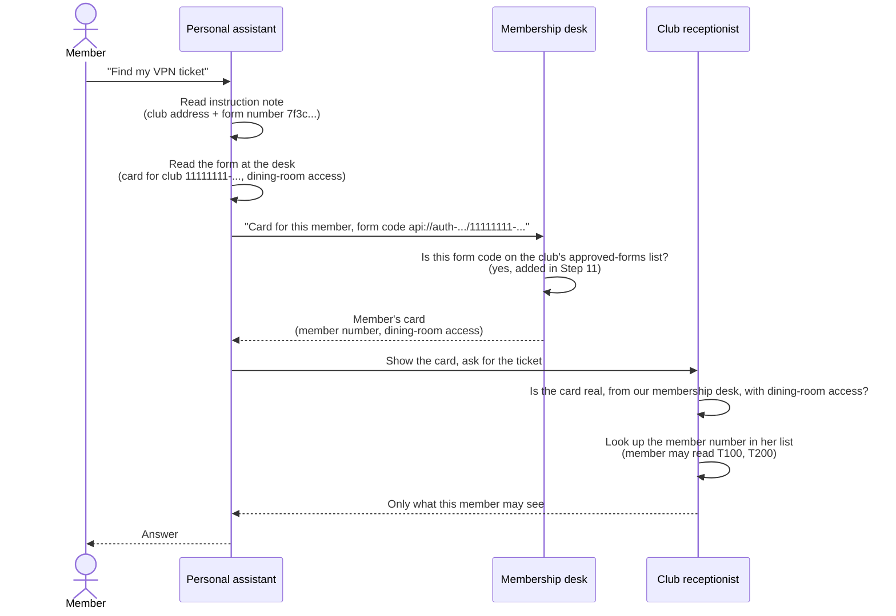

# SSO sign-in, plain version with an analogy

Companion to [How SSO sign-in works](../README.md#how-sso-sign-in-works). All IDs are placeholders.

Copilot is a personal assistant sent to a members-only club (your MCP server) to get something for a member. The club's receptionist only trusts the **member's own card** (access token), never the assistant's word. The **connector** is the assistant's instruction note (MCP URL + SSO registration ID): the club's address, plus which membership desk to visit. The **SSO registration** is the form at the desk (client ID `11111111-…`, scope `api://11111111-…/Tickets.Access`): "card for this club, dining-room access". The desk gives that form a unique **form code** (`api://auth-…`) and only issues cards for it if the club has written the code in its **approved-forms list** (`identifierUris`, Step 11). Only the club can write in that list, so a stranger can't file a form that sends members' cards to their own address. The membership desk (Entra) issues the card in the member's name. The receptionist checks that the card is real (signature, tenant, audience, scope), reads the **member number** (`oid`) on it, and looks it up in her own list (ticket ACL) to decide what that member may do.

| Analogy | Real part |
|---|---|
| Members-only club | MCP server (`https://<tunnel-origin>/mcp/`) |
| Receptionist | The MCP server's token check and ticket ACL |
| Personal assistant | Copilot |
| Assistant's instruction note | Connector (MCP URL + SSO registration ID) |
| Form at the desk | SSO registration (client ID + scope) |
| Club's own name | Application ID URI `api://11111111-…` |
| Form code (unique to this form) | Application ID URI from Teams `api://auth-…/11111111-…` |
| Club's approved-forms list (only the club can write in it) | `identifierUris` (Step 11) |
| Membership desk | Entra |
| Member's card | Access token |
| Card type "dining-room access" | `Tickets.Access` scope |
| Member number | `oid` (user ID) |
| Receptionist's list | Ticket ACL in the server |

